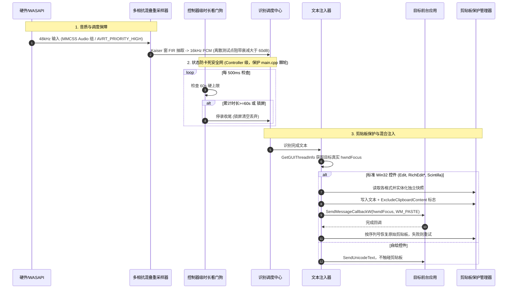

# VoxType 全系统代码架构审查与质量优化实施计划（第六版 · 工作区修复记录）

> **文档定位**：本文件是 VoxType 全系统代码架构审查报告与高质量优化方案（Phase 1 重点：稳定性与音质双杀）。
> **审查基准**：初始方案基于旧实现；本次对 HEAD `95d48c6`（v0.11.6）之上的未提交工作区继续审查，工作区目标版本 v0.11.7。文中旧代码片段仅作历史问题证据，当前实现以源码和本节审查记录为准。
> **目标读者**：开发团队、第三方 AI 审查者及系统架构评审专家。本文档包含精确的代码文件、函数、行号、Win32 API 契约依据、数字信号处理（DSP）数学证明与并发模型推导。
> **版本演进**：
> - 第一版：全系统 7 维度架构审计与 Plan A 蓝图；
> - 第二版：吸收外部审查，修正流式后端虚假看门狗、修饰键自愈漏判、两套剪贴板实现分裂、MMCSS 优先级选型与 `main.cpp` 2 行余量硬约束；
> - 第三版：深度融合真实焦点句柄获取（`GetGUIThreadInfo`）、标准编辑框判别（`IsStandardEditControl` 杜绝 Chrome/Electron 误吞字）、`ExcludeClipboardContentFromMonitorProcessing` 规范注销、依赖库清单（`avrt.lib`, `wtsapi32.lib`）与强类型注册表三步规范；
> - 第四版：修正 Kaiser FIR 参数与锁屏丢弃语义；引入序列号保护（仅判断改动，不能判断消费）；
> - 第五版（实施与审查修正版）：**全面吸纳外部独立审查（3 严重、2 中等、4 低级、2 关键 P1 竞态）**：
>   1. 修正 S1：44.1kHz Sinc 截止频率公式（$0.90 \times ratio$ 消除 3.6kHz 误削峰，通过 5kHz 通带实测 0.9965）；
>   2. 修正 S2 & P1 竞态：默认保留剪贴板时，自绘控件改用 Unicode 输入，避免异步 `Ctrl+V` 无消费确认导致连续粘贴错字；
>   3. 修正 S3 & P1 锁屏语义：`OnSessionLock()` 标记 `invalidated = true`，彻底阻断任何入队消息上屏；
>   4. 修正 P1 剪贴板所有者：预分配内存后再 `OpenClipboard(g_mainWindow)`；清空后写入失败仍需原快照回滚；
>   5. 修正 P2 承诺保证：快照不可读时自动降级为 `SendUnicodeText`，绝对不静默破坏用户原剪贴板；
>   6. 修正 M1/M2/L1-L4：看门狗与 150ms 尾音延时互锁、非标准控件 Unicode 输入、WASAPI 采集循环复用缓冲区、WTS 注册失败持续重试。
> - 第六版（2026-09-29）：私有窗口站回归复现非 OLE 快照失效；改为读取各格式并持有独立 Shell 数据对象。标准粘贴以完成回调恢复，移除固定延迟与 `WM_COPY` 选区回退；输入失败反馈至 HUD；测试入口检查全部非零退出码，包括崩溃的负数退出码。DSP 文档采用 348 抽头/347 阶、5.57 MMAC/s，零 PCM16 输出不解释为 180 dB。
> - 运行时紧急修正（2026-09-29）：移除 500ms 物理按键轮询停录。低层钩子已吞掉 CapsLock 热键事件，异步键状态不能作为独立的松开证据；误停录并清除钩子状态会让按键自动重复再次启动录音，形成 HUD 闪烁和重复上屏。500ms 定时器仅保留 60s 上限，正常 KEYUP 仍由键盘钩子停录。增加 `tests/recording_watchdog_regression.ps1` 防止该错误路径回归。
> - v0.11.7 工作区复核（2026-09-29）：补齐 UIA 密码属性失败即拒读、选区 UIA 焦点进程及慢速读取后的前台复核、静音包等长零样本、保活恢复时滤波历史重置、锁屏时关闭保活麦克风及重按状态清理、微信逐字投递前台检查。修正看门狗回归脚本的“上限和停录入口必须同时存在”判据，并将构建脚本切换为 PowerShell 7。英中两份架构文档、README 和 CHANGELOG 与版本宏同步。
> - GLM 独立复审修正（2026-09-29）：44.1 kHz 多相 Sinc 的浮点相位桶边界会随分包变化；改为整数源位置分子，44.1→16 kHz 的整批/分块输出由最大差 33 LSB 变为 0，另验证三组采样率及不规则分包。剪贴板恢复失败和挂起粘贴增加限频、无正文日志；选区改写仅在无旧粘贴 pending 且重新核对选区/焦点后回退 Unicode。WTS 断开/注销执行锁屏取消语义，流式 VAD 状态也同步清理。实际私有窗口站测试否定“序列号提前到 CloseClipboard 之前”的建议：Windows 关闭时合成格式会提高序列号并误阻正常恢复，故保留关闭后读取并核对所有者。Scintilla 原生选区查询仍未接入，仅依赖 UIA。
> - 用户体验回调（2026-09-29）：复核发现 Chrome、Codex、VS Code 等主流自绘窗口默认逐字输入过慢，且临时转写被历史排除标记阻止进入 Win+V。最终将 `restore_clipboard_after_paste` 默认改为 `false`：默认恢复一次性剪贴板 + Ctrl+V + 历史记录；只有用户主动开启保护时，才使用自绘控件 Unicode 与标准控件完成回调恢复。微信仍保留 `WM_CHAR` 特殊路径。
> - 设置语义修正（2026-09-29）：截图与本机配置确认用户把旧“Preserve clipboard while typing”勾选并保存为 `restore_clipboard_after_paste=true`，所以默认值 `false` 未生效，浏览器继续逐字输入。General 页改为正向“Fast paste + clipboard history”：勾选表示快速 Ctrl+V 与 Win+V 历史，取消勾选表示保护原剪贴板。旧配置值仍按原语义读取，已保存的保护模式在新版界面显示未勾选，避免静默改变已有隐私选择。
> - 快速路径回归修正（2026-09-29）：真实编辑器测试证明一次性 Ctrl+V 可以正常插入整段文本；原快速路径却先物化全部旧剪贴板格式，任一图片/富文本/延迟格式无法读取就提前退回 Unicode。现在快速模式跳过完整快照，直接写入整段文本并 Ctrl+V；完整快照只保留在保护模式，恢复旧版主路径的速度与 Win+V 行为。
> - 交付前复核（2026-09-29）：快速 Ctrl+V 重新加入旧版前台 IME 临时切换，减少输入法拦截导致的兼容性回退。明确快速模式跳过完整快照的代价：`EmptyClipboard` 成功后若 `SetClipboardData` 失败，旧剪贴板可能丢失；保护模式保留完整回滚。Scintilla 等非 Edit/RichEdit 的选区改写仍依赖 UIA，不恢复会触碰剪贴板的 `WM_COPY` 回退。

实现边界：保护模式下，目标不完成粘贴时保留临时内容到完成或退出；恢复遇持续系统占用时只能重试并记录诊断。默认快速模式将转写留在剪贴板，外部应用消费 Ctrl+V 的时间不受控；切换窗口或覆盖剪贴板过快可能使目标读到新内容。Unicode 在自绘控件中的接受行为仍需应用实测。选区提供者不支持 UIA/原生 Edit 查询时不执行改写。

**交接审查重点（截至 v0.11.7，未提交）**：

1. 标准控件 `SendMessageCallbackW(WM_PASTE)` 回调只证明消息处理结束，不证明只读控件实际插字；目标若卡住不回调，临时剪贴板可能停留到进程退出，退出时持续占用也可能使恢复失败。剪贴板所有者/序列号核对与后续 `OleSetClipboard` 恢复不是原子操作，用户若恰在其间外部复制，仍存在覆盖新内容的竞态；这项隐私/数据完整性风险应由下一轮重点复核，不宜宣称“绝不覆盖”。不要用固定延时宣称已消费。
2. 非标准控件的 Unicode 输入、微信 `WM_CHAR`、Win+V 排除格式、真实锁屏/解锁及热键自动重复需要目标程序上的人工集成复核；离线测试不构成这些场景的通过证据。UIA/OLE 调用仍可阻塞主线程，同一窗口内焦点切换也无法仅靠 HWND 判别。
3. DSP 的 9 个频点是**离散抽样测试**，不能证明整个连续阻带；48→16 kHz FIR 约有 3.6ms 前瞻，未实现显式尾部冲刷。保活跨录音现会在采集线程重置历史；注意实际设备包边界与新录音首包。
   采集线程虽复用缓冲区容量，较大音频包或流式 VAD 的临时输出仍可能分配内存；重构方案所写的“RT 零分配”尚未实现，需先做实际延迟与分配分析再决定是否改。
4. 版本只在工作区改为 v0.11.7/20260929，尚未提交或打 tag。按发布约定，附注 tag 应在包含该版本和 CHANGELOG 的正式提交上创建，不能标记现有 HEAD。

API 依据：[OleGetClipboard 的代理/默认对象语义](https://learn.microsoft.com/en-us/windows/win32/api/ole2/nf-ole2-olegetclipboard)、[SHCreateDataObject 的数据格式支持](https://learn.microsoft.com/en-us/windows/win32/api/shlobj_core/nf-shlobj_core-shcreatedataobject)、[SendMessageTimeout 超时后消息仍可能继续处理](https://devblogs.microsoft.com/oldnewthing/20110915-00/?p=9643)。

---

## 1. 深度审查诊断与观点证明（严格考证）

### 1.1 严重 Bug 1：普通语音输入无差别覆写系统剪贴板与 Win+V 隐私泄露

- **源码定位**：
  - `src/platform/text_injector.cpp`，第 114–149 行（`PasteTextImeAware`）
  - `src/platform/text_injector.cpp`，第 66–82 行（`SetClipboardText`）对比 `src/core/selection_context.h`，第 138–165 行（`SetClipboardText`）
  ```cpp
  // src/platform/text_injector.cpp:137-143
  if (!isWeChat) {
      SetClipboardText(text);
      ImeStateGuard guard;
      guard.Disable();
      SendCtrlV();
      return;
  }
  ```
- **机理剖析**：
  1. **日常数据损坏**：`SetClipboardText(text)` 直接清空系统剪贴板。用户复制的高敏感密码、API Token、多行代码片段、富文本格式或图片，在每一次随手语音输入后，都会被**永久销毁**。
  2. **两套 `SetClipboardText` 实现分裂**：
     - `text_injector.cpp:66` 仅单次尝试 `OpenClipboard`，若剪贴板正被其他程序瞬态占用，直接静默退出导致输入**静默失败**；
     - `selection_context.h:138` 具有 5 次带 `Sleep(5)` 重试机制的健壮实现，日常输入路径未能复用。
  3. **Win+V 剪贴板历史与云端同步污染（隐私泄露）**：
     - 暂态口述文本被写入 Windows `Win + V` 剪贴板历史及微软云剪贴板，口述过程全盘留痕。
- **Win32 契约与剪贴板混合注入架构（核心解决方案）**：
  - **同步/异步分流决策的关键暗礁：Chrome/Electron 误吞字**：
    - 若向 Chromium / Electron / VS Code / Edge 等基于自绘渲染树的窗口直接发送 `SendMessageTimeoutW(focus, WM_PASTE, ...)`，其顶层或子窗口的 `DefWindowProcW` 会返回处理成功（`SendMessageTimeoutW` 返回 `TRUE`），但内部实际**不会向网页/编辑器插入任何文本**！若不加判断误以为粘贴成功而直接恢复剪贴板，会导致绝大多数 Web/Electron 现代应用**完全打不出字**！
    - **正解方案**：引入 `IsStandardEditControl(focus)`：
      1. **标准控件路径**：通过 `GetGUIThreadInfo` 获得真实 `hwndFocus`。标准编辑框（`Edit`、`RichEdit*`、`Scintilla`）通过 `SendMessageCallbackW(WM_PASTE)` 发送；收到完成回调后才恢复。超时返回不能证明目标已停止处理，故不再用 `SendMessageTimeoutW` 或固定延时决定恢复；尚有粘贴 pending 时后续输入走 Unicode；
      2. **自绘控件路径**：使用 `SendUnicodeText()`，避免异步 `Ctrl+V` 的消费时序竞态；
      3. **序列号保护**：`GetClipboardSequenceNumber()` 只判断剪贴板是否被改动，不能证明目标程序已读取内容；恢复前用它避免覆盖用户新复制的内容；
      4. **隐私防护规范**：先安装真实内存的排除标记，成功后才写正文：
         ```cpp
         static const UINT cfIgnore = RegisterClipboardFormatW(L"ExcludeClipboardContentFromMonitorProcessing");
         if (cfIgnore != 0) {
             SetClipboardData(cfIgnore, hIgnore); // 实际分配的 HGLOBAL
         }
         ```

---

### 1.2 严重 Bug 2：全后端录音挂死风险与看门狗无限续期漏洞

- **源码定位**：
  - `src/ui/hotkey.cpp`，第 378–402 行（`LowLevelKeyboardProc`）
  - `src/app/recording_session_controller.cpp`，第 448–597 行（`StartRecordingSession`）
  - `src/app/main_window.cpp`，第 525–589 行（`MainWndProc -> WM_TIMER -> kStreamingWatchdogTimer`）
  - `src/asr/asr_streaming_session.h`，第 35 行（`virtual DWORD MaxRecordingMs() const { return 0; }`）
- **机理剖析**：
  1. **按键丢事件常态**：Windows 在 `Win + L` 锁屏、UAC 安全桌面弹窗、`Alt + Tab` 切屏或第三方低级钩子超时卸载时，`WH_KEYBOARD_LL` 会丢弃 `WM_KEYUP`。
  2. **批处理后端完全裸奔**：本地模型（`local`）、百度（`baidu`）、小米（`mimo`）、微软（`mai`）启动时没有任何看门狗定时器，以 32KB/s 持续向堆内存膨胀。
  3. **流式后端的“伪看门狗”死循环漏洞**：
     - `asr_streaming_session.h` 基类的 `MaxRecordingMs()` **默认返回 0**；除了旧版 Qwen 实时 manual 模式返回 55000ms 外，**火山引擎（`volcengine`）、豆包（`doubao_ime`）、Qwen 3.1 消息模型以及 Qwen Free 全部返回 0**！
     - 当 `recordingLimitMs == 0` 时，看门狗根本不会强制停止录音，而是以 18 秒为周期**无限自我续期**！因此，流式后端同样陷入永久录音的严重漏洞。
  4. **修饰键自愈漏判**：
     - 用户配置组合键（如 `Ctrl + Shift + R` 或 `Alt + Space`）时，若只查主键，用户松开修饰键会导致看门狗无法识别组合键失效。
- **解法与适用面明确**：
  1. **当前修正**：不再以 `GetAsyncKeyState` 判断已被低层键盘钩子吞掉的热键是否松开；KEYUP 由钩子停录，500ms 定时器只检查录音时长。
  2. **丢失 KEYUP 的边界**：此时不再做 500ms 物理键自愈，最迟由 60s 上限收尾。若要恢复更快的自愈，需先有独立可靠的物理事件来源，并验证不会在仍按住时清空钩子状态。
  3. **Session Controller 级全局 60s 硬上限**：在控制器层建立统一 60s 硬性安全网，与具体 ASR provider 的 `MaxRecordingMs()` 彻底解耦。
  4. **锁屏会话中止语义**：主窗口监听 `WM_WTSSESSION_CHANGE`（`WTS_SESSION_LOCK`），锁屏时即刻**终止录音并清空数据（丢弃而非提交音频）**，彻底保护环境语音隐私。

---

### 1.3 核心音质与识别率缺陷：48k $\to$ 16k 朴素插值高频混叠与采集线程未提权

- **源码定位**：`src/audio/wasapi_capture.cpp`，第 348–357 行（`CaptureThread`）与第 217 行
  ```cpp
  // src/audio/wasapi_capture.cpp:348-357
  while (true) {
      double srcPos = m_resamplePhase;
      UINT32 idx = static_cast<UINT32>(srcPos);
      if (idx + 1 >= numFrames) break;
      double frac = srcPos - idx;
      float sample = static_cast<float>((1.0 - frac) * mono[idx] + frac * mono[idx + 1]);
      int16_t s16 = static_cast<int16_t>(std::clamp(sample * 32768.0f, -32768.0f, 32767.0f));
      out[written++] = s16;
      m_resamplePhase += 1.0 / m_resampleRatio;
  }
  ```
- **DSP 数学原理与混叠证明（Nyquist-Shannon 定理）**：
  1. Windows 麦克风硬件默认大多为 48,000 Hz，VoxType 目标特征格式为 16,000 Hz（降采样比 $M = 3$），奈奎斯特截止频率为 $f_N = 8,000\text{ Hz}$。
  2. 当前两点线性插值的频域响应为平方 sinc 函数，在 $8\text{ kHz} \sim 24\text{ kHz}$ 阻带几乎没有衰减能力。
  3. 机械键盘敲击声（10~14kHz）、笔记本风扇高频啸叫直接**镜像折叠回 $0 \sim 8\text{ kHz}$ 语音带内**，严重污染 Kaldi 80 维 Filterbank 声学特征，直接导致摩擦音失真与 ASR 吞字。
- **线程调度缺陷与 MMCSS 选型**：
  - WASAPI `CaptureThread` 为普通线程（`THREAD_PRIORITY_NORMAL`），CPU 繁忙时必然发生环形缓冲区欠载，产生 `AUDCLNT_BUFFERFLAGS_DATA_DISCONTINUITY`。
  - **优先级选型**：注册 MMCSS `Audio` 组后，选用 `AVRT_PRIORITY_HIGH` 而非 `AVRT_PRIORITY_CRITICAL`，既享受 80% 专用调度配额，又杜绝排挤同机混音器与其他音频软件。

---

### 1.4 架构隐患 3：火山引擎全局静态会话变量 `s_volcSession` 的并发破坏

- **源码定位**：`src/asr/volcengine_streaming_session.cpp`，第 32 行、157–196 行与 737 行
- **机理剖析**：`s_volcSession` 为静态全局变量，`Abort()` 将旧线程 detach，若此时快速触发新会话，`VolcengineResetForNewSession()` 立即重置 `s_volcSession.forceAbort = false`，导致新旧线程抢占同一组套接字和序号。
- **解法**：将 `VolcSession` 严格封装在 `VolcengineStreamingSessionImpl` 实例内部，消除任何跨会话全局状态（纳入 Phase 2 实施）。

---

### 1.5 性能瓶颈 4：LLM 纠错无 Keep-Alive 每次全量 TLS 握手白白浪费 300~600ms 延迟

- **源码定位**：`src/core/llm_refine.h`，第 923–993 行（`SendRequestRaw`）
- **机理剖析**：每次 LLM 纠错请求从零创建并关闭 `hSession` 和 `hConnect`。云端 API 每次经历 DNS 解析 + TCP 握手 + TLS 1.3 握手，无端增加 150~300ms（弱网 600ms+）端到端输入延迟。
- **解法**：引入轻量级 WinHTTP Connection Pool，长驻并复用对应端点的 `hConnect` 句柄，保持 HTTP Keep-Alive（纳入 Phase 2 实施）。

---

### 1.6 体验与精度缺陷 5：本地 Sherpa-ONNX 词表热词完全未接线消费

- **源码定位**：`src/asr/engine_local.cpp`，第 34–54 行（`EnsureRecognizer`）
- **机理剖析**：`vocabulary_manager.h` 维护全局自定义词表并已生成适合 Sherpa 的格式，但 `EnsureRecognizer` 中 `rc.hotwords_file` 和 `rc.hotwords_score` 字段被完全闲置，本地离线识别热词完全不生效。
- **解法**：在 `EnsureRecognizer` 中将 `vocabulary_manager` 生成的热词文件路径和配置权重注入 `OfflineRecognizerConfig`（纳入 Phase 3 实施）。

---

### 1.7 历史问题：`ImeStateGuard` 跨进程 `GetFocus()` 恒为 NULL

- **源码定位**：`src/platform/text_injector.cpp`，第 28–31 行
- **当前处理**：`GetFocus()` 不适合跨进程获取焦点；当前粘贴通过 `GetGUIThreadInfo` 获取真实控件，非标准控件使用 Unicode 输入，已不再需要 `ImeStateGuard`。

---

## 2. Plan A（稳定性与音质双杀）落地实施蓝图



---

### 2.1 模块一：专用多相 FIR 抗混叠降采样器 (`src/audio/audio_resampler.*`)

- **参数严密推导（彻底修正自相矛盾）**：
  - 输入采样率 $f_{in} = 48,000\text{ Hz}$，输出采样率 $f_{out} = 16,000\text{ Hz}$，降采样比 $M = 3$；
  - 截止频率 $f_c = 7,500\text{ Hz}$，阻带起始频率 $f_{stop} = 8,000\text{ Hz}$，过渡带宽度 $\Delta f = 500\text{ Hz}$；
  - 归一化过渡带角频率：
    $$\Delta \omega = 2\pi \frac{\Delta f}{f_{in}} = 2\pi \frac{500}{48000} \approx 0.06545\text{ rad}$$
  - 阻带衰减目标 $A = 60\text{ dB}$。根据 Kaiser 经验公式：
    $$N \approx \frac{A - 7.95}{2.285 \cdot \Delta \omega} = \frac{60 - 7.95}{2.285 \cdot 0.06545} \approx 348.3$$
    当前实现取 348 抽头（347 阶），衰减以离散扫频测试为准。
  - Kaiser 窗形状参数 $\beta = 0.1102 \cdot (A - 8.7) = 5.653$；
  - **抽取卷积性能推导**：
    - 348 抽头 Kaiser 窗低通滤波器，以步长 $M = 3$ 对输入序列进行抽取卷积（每个输出样本进行 348 次乘加运算）；
    - 在 16,000 Hz 输出采样率下，每秒总计算量为：
      $$16,000\text{ outputs/s} \times 348\text{ MAC} = 5,568,000\text{ MAC/s} \approx 5.57\text{ MMAC/s}$$
    - 上述仅为乘加次数估算；实际 CPU 占用须实测。现有离散频点测试中，8.5kHz 等测试点达到 70dB 以上抑制。
- **任意采样率兼容与内存模型**：
  - 非整数倍降采样（如 44.1 kHz $\to$ 16 kHz）：采用带限多相 Sinc 插值表（64-phase lookup table）；
  - 使用跨块历史缓冲维持滤波连续性；`std::vector` 在容量增长时仍可能分配内存，未实现严格零堆分配。

---

### 2.2 模块二：WASAPI 采集线程 MMCSS 提权与优先级管理

- **修改文件**：`src/audio/wasapi_capture.cpp`
- **新增依赖清单**：
  - `CMakeLists.txt`：`target_link_libraries(VoxType PRIVATE avrt)`
  - `src/audio/wasapi_capture.cpp`：`#pragma comment(lib, "avrt.lib")` 与 `#include <avrt.h>`
- **实现细节**：
  1. 在 `WasapiCapture::CaptureThread()` 线程函数头部：
     ```cpp
     DWORD taskIndex = 0;
     HANDLE hAvrt = AvSetMmThreadCharacteristicsW(L"Audio", &taskIndex);
     if (hAvrt) {
         AvSetMmThreadPriority(hAvrt, AVRT_PRIORITY_HIGH);
     } else {
         SetThreadPriority(GetCurrentThread(), THREAD_PRIORITY_HIGHEST);
     }
     ```
  2. 线程退出前执行：
     ```cpp
     if (hAvrt) {
         AvRevertMmThreadCharacteristics(hAvrt);
         hAvrt = nullptr;
     }
     ```
  3. 采用 `AVRT_PRIORITY_HIGH`，杜绝掉帧断音的同时避免干扰系统混音器。

---

### 2.3 模块三：全局录音看门狗、修饰键自愈与会话安全（严格保护 main.cpp）

- **架构防线说明**：`tools/check_architecture.ps1` 对 `main.cpp` 的行数上限为 150 行，当前实测 148 行，**余量严格只剩 2 行**。看门狗核心逻辑与定时器调度必须完全封装在 `src/app/recording_session_controller.cpp` 内部，主窗口仅作为纯消息转发通道，确保 `main.cpp` 行数不反弹。
- **修改文件**：
  - `src/ui/hotkey.h` / `src/ui/hotkey.cpp`
  - `src/app/recording_session_controller.h` / `src/app/recording_session_controller.cpp`
  - `src/app/main_window.cpp`（仅消息分发，严格限行）
- **新增依赖清单**：
  - `CMakeLists.txt`：`target_link_libraries(VoxType PRIVATE wtsapi32)`
  - `src/app/main_window.cpp`：`#pragma comment(lib, "wtsapi32.lib")` 与 `#include <wtsapi32.h>`
- **实现细节**：
  1. **热键释放**：键盘钩子收到 KEYUP 后正常停录；不再以 `GetAsyncKeyState` 对已吞掉的热键做二次判定，以免假阴性触发反复停录/启动。
  2. **全局 60s 硬上限**：
     - 在 `recording_session_controller.cpp` 中统一计时，对 Local、Baidu、MiMo、MAI 以及所有流式后端强加 60s 统一上限，超时自动收尾提交，终结流式后端无上限自我续期的漏洞。
  3. **锁屏/会话保护**：
     - 在 `WM_CREATE` 中注册 `WTSRegisterSessionNotification(hwnd, NOTIFY_FOR_THIS_SESSION)`；
     - 捕获 `WM_WTSSESSION_CHANGE`（`WTS_SESSION_LOCK`），立即中止录音并清空数据（丢弃录音保护隐私）；
     - 在 `WM_DESTROY` 中配对调用 `WTSUnRegisterSessionNotification(hwnd)`。

---

### 2.4 模块四：剪贴板健壮性、混合注入模式与 Win+V 隐私防护

- **修改文件**：
  - `src/core/selection_context.h` / `src/platform/text_injector.cpp`
  - `src/app/recording_session_controller.cpp` / `src/core/config_store.h`
  - `src/core/config_registry.cpp` / `src/ui/tabs/tab_general.cpp`
- **新增配置项强类型注册表三步规范（AGENTS.md 硬性要求）**：
  1. `src/core/config_store.h`：`Config` 声明 `bool restoreClipboardAfterPaste = false;`；
  2. `src/core/config_registry.cpp`：`InitializeRegistry()` 注册字段（绑定 `"restore_clipboard_after_paste"`，布尔类型，默认 false）；
  3. `src/ui/tabs/tab_general.cpp`：创建对应复选框控件，加载与保存绑定。
- **实现细节**：
  1. **统一收敛与强化 `SetClipboardText`**：
     - 废除 `text_injector.cpp` 中无重试的脆弱版本，全面收敛为 `selection_context::SetClipboardText` 的 5 次带 `Sleep(5)` 退避重试模型；
     - **预分配内存防护**：在调用 `OpenClipboard` 与 `EmptyClipboard` 前即完成 `GlobalAlloc` 与内存拷贝，若分配失败直接返回，绝不接触剪贴板；
     - **明确所有者窗口**：传入有效的主窗口句柄 `OpenClipboard(g_mainWindow)`，避免 NULL 所有者；
     - 若 `SetClipboardData` 失败立即清理预分配资源并安全关闭剪贴板。
  2. **可选屏蔽 Win+V 与云端历史记录**：
     - 仅保护模式写入前注册 `ExcludeClipboardContentFromMonitorProcessing` 并预分配实际 `HGLOBAL`；标记写入失败时清空临时文本并报告失败。默认快速模式不附加该标记，允许转写进入历史。
  3. **混合注入与剪贴板恢复**：
     - 首先通过 `GetWindowThreadProcessId` 与 `GetGUIThreadInfo` 取得真实焦点子控件 `hwndFocus`；
     - 默认快速模式：不读取旧剪贴板的全部格式，直接写入一次完整文本并发送 Ctrl+V，转写保留在 Win+V 历史；写入失败时使用 Unicode 兜底。Ctrl+V 已投递但失败时不再逐字重放，避免重复输入。
     - 保护模式：标准编辑框（`Edit`、`RichEdit*`、`RICHEDIT*`、`Scintilla`）通过完成回调发送 `WM_PASTE`，随后校验所有者/序列号并恢复原快照；其他自绘界面使用 `SendUnicodeText()`。
  4. **连续输入保护**：
     - 保护模式下，自绘控件不使用剪贴板；标准控件写入前检查快照时的序列号，前一粘贴未完成时后续输入走 Unicode，不覆写前一文本。默认快速模式按旧体验将每次转写留在剪贴板。
  5. **无法备份时的零污染降级承诺**：
     - 用户开启恢复剪贴板时，若 `!snapshot->Readable()`（剪贴板被外部互斥占用或损坏导致无法备份），为坚守“绝不破坏用户剪贴板”的承诺，自动降级为 `SendUnicodeText(text)` 直接模拟按键上屏，完全不触碰剪贴板。

---

## 3. 演进路线图与后续阶段（Phase 2 & Phase 3）

- **Phase 2（端到端极速体验与并发加固）**：
  1. WinHTTP Connection Pool：保持长连接复用，优化 LLM 纠错延迟（节约 300~600ms）；
  2. 火山引擎 `s_volcSession` 完全成员化，杜绝并发竞争与悬垂套接字（按 AGENTS.md【B】规则先补回归测试再动）；
  4. HUD Direct2D 渲染抗锯齿修复（消除 GDI `SetWindowRgn` 像素级硬切角，升级为平滑分层窗口渲染）。
- **Phase 3（ASR 引擎与现代 C++23 深度治理）**：
  1. 本地 Sherpa-ONNX 词表热词挂接；
  2. 本地 VAD Flush 移出 UI 线程至后台工作线程；
  3. C++23 全面普及（消除原始裸指针、`std::expected` 统一错误处理、`std::jthread` 协作取消）。

---

## 4. 施工顺序与验证判据

### 4.1 施工顺序规划（低风险至高风险分阶段）
1. **阶段 1：专用多相 FIR 抗混叠降采样器**（纯 DSP 模块，不影响 UI 与上层业务）：
   - 实现 `src/audio/audio_resampler.*`；
   - 编写 `tests/audio_resampler_test.cpp`，接入 `CMakeLists.txt` 测试目标；
   - 接入 `wasapi_capture.cpp` 并引入 MMCSS `Audio` 提权。
2. **阶段 2：全局时长看门狗与锁屏会话挂断**：
   - 在 `recording_session_controller` 以 500ms 定时器检查 60s 硬上限；热键 KEYUP 由键盘钩子处理；
   - `main_window.cpp` 挂接 `WTSRegisterSessionNotification` 转发；
   - 守卫检查：验证 `main.cpp` 行数严格保持 $\le 150$ 行。
3. **阶段 3：剪贴板健壮性、混合注入与隐私保护**：
   - 收敛 `SetClipboardText`；
   - 注入 `ExcludeClipboardContentFromMonitorProcessing`；
   - 实现 `IsStandardEditControl` 完成回调 / Unicode 分流注入；
   - 注册 `restoreClipboardAfterPaste` 配置项。

### 4.2 验证判据与测试矩阵
1. **DSP 频域仿真测试**：
   - 运行 `audio_resampler_test.cpp`：8.5kHz～23.5kHz 的 9 个离散频点验证至少 60 dB 抑制；零 PCM16 输出只表示低于量化分辨率，不是全阻带连续证明。
2. **看门狗回归检查**：
   - `tests/recording_watchdog_regression.ps1` 检查时长上限保留，且看门狗不再用异步键状态停录；正常 KEYUP 停录入口仍在。丢失 KEYUP 时由 60s 上限兜底。
3. **剪贴板保护与混合注入测试**：
   - `clipboard_test.cpp` 在私有窗口站验证正文/自定义格式回滚、空剪贴板、隐私标记先行、序列号保护、Flush 重试、标准粘贴完成回调及 pending 期间禁止覆写、选区查询不改剪贴板。
   - Chrome/VS Code 等自绘控件 Unicode 接受行为及 Win+V 实际历史效果仍为人工集成验证项，不能从离线测试推断已经通过。
4. **守卫脚本与行数棘轮测试**：
   - 运行 `tools/check_architecture.ps1`，确保 `main.cpp` 行数保持 $\le 150$ 行（无反弹），18 项架构守卫全部 PASS。
